# 猫狗宠物之家 PetHome

**社区 · 商城 · 服务预约 · AI 养护，一站式宠物生活平台**

## 项目简介

猫狗宠物之家围绕养宠家庭的日常生活，把宠物社区分享、宠物商城购物、到店服务预约、宠物健康档案与 AI 养护助手串成一条完整链路。

系统包含用户端 Web、商家中心和管理后台三端，共用一套 Spring Boot 服务。用户在社区晒宠交流、在商城下单、预约洗护寄养等服务；商家在商家中心管理店铺、商品与预约档期；管理员在后台完成内容审核、用户与商家治理。AI（DeepSeek）用于养宠顾问对话与健康报告生成，也参与社区评论的异步审核；养护知识库检索基于关键词 + 向量的混合检索（百炼 Embedding + Milvus，可选开启），仅辅助 AI 问答，不参与交易与库存记账。服务端同时内置 MCP Server，把宠物健康档案、知识库检索与养护提醒暴露为标准 MCP 工具。

## 核心能力

- **账号与角色**：用户名密码登录（BCrypt 存储）、注册、JWT Cookie 会话、登出 Token 黑名单；用户 / 商家 / 管理员三角色路由守卫，接口按角色隔离。
- **宠物社区**：帖子发布与图片上传、点赞、关注、评论；评论经敏感词初筛后由 RabbitMQ 异步 AI 审核，AI 不可用时自动转人工复核，管理端提供审核队列与审核日志。
- **宠物商城**：两级商品分类树（主粮、零食、营养保健、清洁护理等）、商品搜索与详情、购物车按店铺勾选结算、下单 / 取消 / 确认收货，低库存预警进商家待办。
- **服务预约**：美容洗护、寄养托管、训练行为等服务类目；商家自定义预约档期与容量，用户按天选槽预约，预约开始前由定时任务推送提醒。
- **商家中心**：店铺组织（旗舰店 + 服务门店）管理、商品 / 服务上下架、订单发货、预约履约、经营总览（累计营业额、今日待办、低库存商品）。
- **宠物养护**：宠物档案（品种、体重、过敏史、疫苗与驱虫记录）、体重记录、养护提醒定时扫描；AI 养宠顾问基于 DeepSeek 流式对话，可引用养护知识库回答；AI 健康报告一键导出 PDF（PDFBox + 开源中文字体）。
- **养护知识库**：管理端维护文章与分块，开启 RAG 后经百炼 Embedding 向量化写入 Milvus，关键词 + 向量 RRF 混合检索为 AI 问答提供上下文。
- **消息中心**：用户私信会话、商家客服接待、管理端通知发布（fanout 扇出写库）。
- **管理后台**：运营总览、用户 / 商家 / 店铺 / 社区 / 知识库管理、评论人工复核、通知发布与审计日志。
- **MCP Server**：以 SSE 传输暴露宠物健康档案查询、知识库检索、养护提醒等工具，可接入 MCP Inspector 或支持 MCP 的 IDE 客户端。
- **可靠性设计**：RabbitMQ 发布确认 + mandatory 回退 + 消费重试；订单支付超时经 TTL 死信队列关单并配兜底轮询；评论审核链路人工兜底。

## 技术栈

| 组件 | 版本 |
| --- | --- |
| Java | 21 |
| Spring Boot | 3.4.13 |
| Spring AI | 1.0.9（DeepSeek Chat + Milvus VectorStore + MCP Server） |
| MyBatis Spring Boot | 3.0.3 |
| MySQL | 8.0 |
| Redis | 7.4（ACL 账号 + Lettuce 连接池） |
| RabbitMQ | 3.13（评论审核 / 通知扇出 / 订单超时三条链路） |
| Druid | 1.2.27 连接池 |
| JJWT | 0.12.5 |
| Spring Security Crypto | 6.4（BCrypt 密码散列） |
| Apache PDFBox | 3.0.5（健康报告 PDF，Ma Shan Zheng 字体，OFL 授权） |
| Vue | 3.5 |
| Vite | 7 |
| Pinia | 3 |
| Vue Router | 4.5 |
| lucide-vue-next | 0.468 图标库 |
| Node.js | 20.19+ / 22.12+（Vite 7 要求） |
| Maven | 3.9+ |
| Nginx | 部署反代（配置见 `deploy/nginx-pet-home.conf`） |

## 系统架构

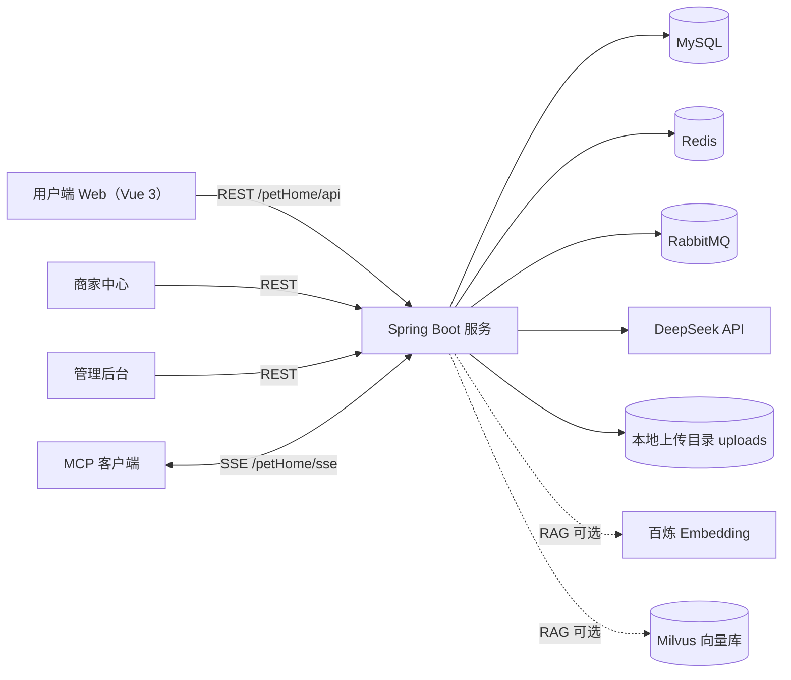

REST 接口统一挂在 `/petHome/api`（同时兼容 `/api` 与 `/api/v1` 两套别名），由 JWT 登录拦截器与角色校验共同保护，会话凭据为 HttpOnly Cookie `pet_home_token`。RabbitMQ 承载三条链路：评论 AI 审核（工作队列，AI 失败转人工复核）、站内通知扇出（fanout）、订单支付超时关单（10 分钟 TTL 死信 + 兜底轮询）。库存与订单真相由 MySQL 与服务端状态机维护；DeepSeek 仅用于养宠顾问对话、健康报告与评论审核判断，RAG 检索默认关闭（`RAG_ENABLED=false`），关闭时零连接。

## 代码结构

```text
backend/                              Spring Boot 服务（pet-home）
├── pom.xml
├── database/full/
│   └── pet_home_full_schema.sql      建库脚本 + 演示数据（账号、店铺、商品、知识库等）
└── src/main/
    ├── java/com/hnist/
    │   ├── controller                REST 接口（用户 / 商家 / 管理端）
    │   ├── service                   业务接口与实现（AI 顾问、审核、订单、看板等）
    │   ├── security                  JWT 签发校验、Token 黑名单、MCP API Key 拦截
    │   ├── mq                        RabbitMQ 配置、消息体与三个消费者
    │   ├── job                       定时任务（预约提醒、健康提醒、订单兜底关单等）
    │   ├── mcp                       MCP 工具（健康档案 / 知识库 / 提醒）
    │   ├── mapper                    MyBatis 数据访问
    │   ├── entity / domain           数据库实体与领域模型
    │   ├── dto / vo                  请求与响应模型
    │   ├── common                    统一响应、业务异常与工具
    │   ├── config                    Redis、MQ、AI、RAG 装配等配置
    │   └── support                   AI 健康报告 PDF 渲染等支撑组件
    └── resources/
        ├── application.yml           主配置（端口、数据源、MQ、AI、MCP）
        ├── application-dev.yml       开发默认值（dev 数据库密码、JWT 密钥）
        ├── application-prod.yml      生产配置基线
        ├── mapper                    MyBatis XML
        ├── moderation                敏感词词库资源
        └── fonts                     PDF 报告中文字体（OFL 授权）

frontend/                             Web 前端（pet-home-web）
├── vite.config.js                    base=/petHome/，/api 与 /uploads 代理到后端
└── src/
    ├── views/user                    首页、社区、商城、服务、养护、购物车、消息、个人中心
    ├── views/merchant                商家经营总览、店铺、商品 / 服务、预约、消息
    ├── views/admin                   运营总览、用户 / 商家 / 社区 / 知识库管理、通知发布
    ├── components                    用户端布局、控制台布局与业务组件
    ├── stores / services             Pinia 状态、REST 与 SSE 封装
    └── router                        路由与角色守卫

deploy/                               部署留档
├── nginx-pet-home.conf               Nginx 站点配置（静态资源 + API / uploads 反代）
├── redis/docker-compose.yml          Redis 7.4（ACL 账号，仅绑定 127.0.0.1）
└── rabbitmq/docker-compose.yml       RabbitMQ 3.13（5673 / 15673，含三条链路说明）
```

## 运行截图

以下截图取自本地实际运行界面（后端 `localhost:8080` + 前端 `127.0.0.1:5173`）。

### 用户端（PC）

<table>
  <tr>
    <td width="50%" align="center">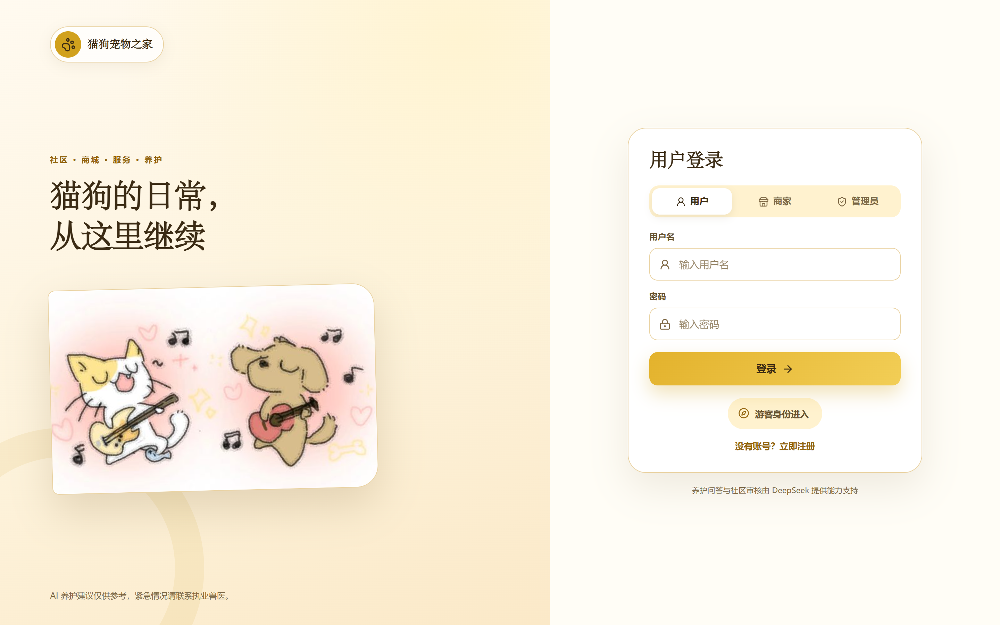<br /><sub>登录页（用户 / 商家 / 管理员三种身份）</sub></td>
    <td width="50%" align="center">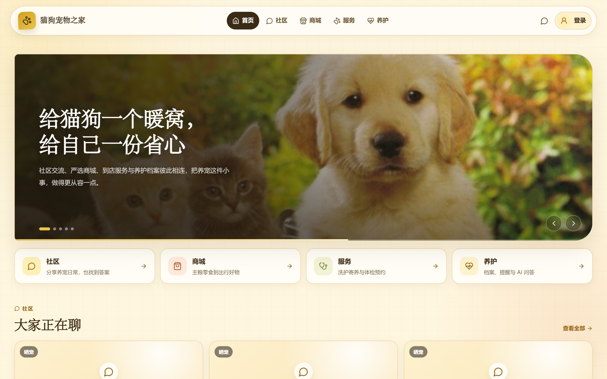<br /><sub>首页</sub></td>
  </tr>
  <tr>
    <td width="50%" align="center">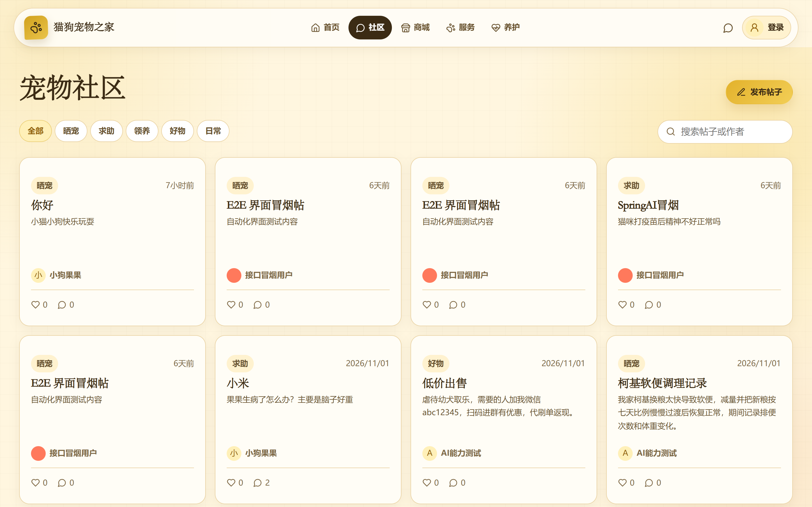<br /><sub>宠物社区</sub></td>
    <td width="50%" align="center">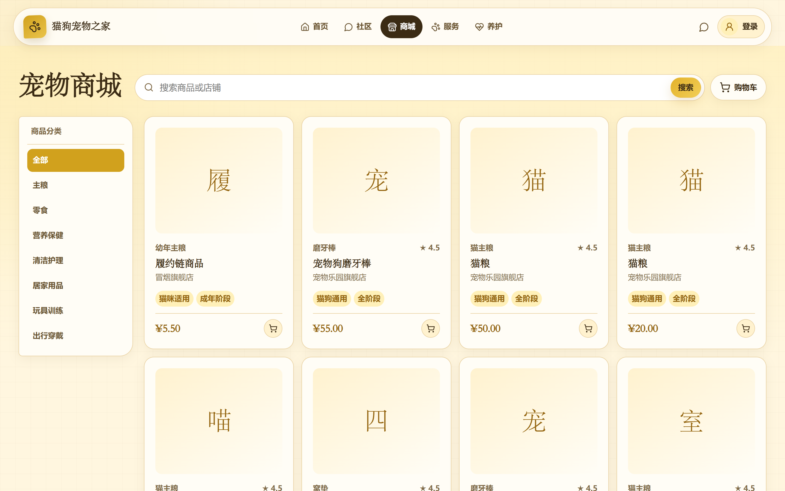<br /><sub>宠物商城</sub></td>
  </tr>
  <tr>
    <td width="50%" align="center">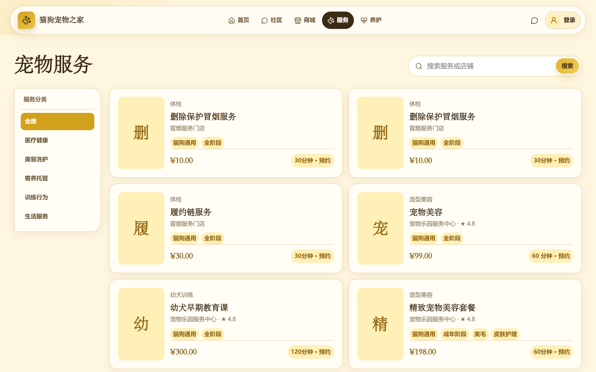<br /><sub>服务预约</sub></td>
    <td width="50%" align="center">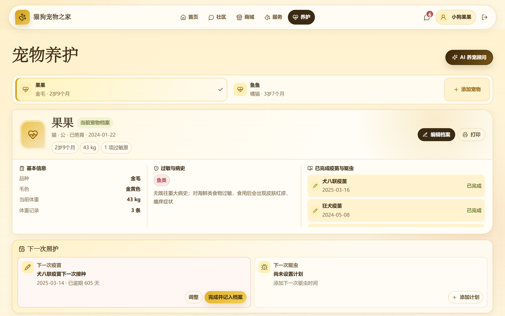<br /><sub>宠物养护（健康档案与 AI 养宠顾问）</sub></td>
  </tr>
  <tr>
    <td width="50%" align="center" colspan="2">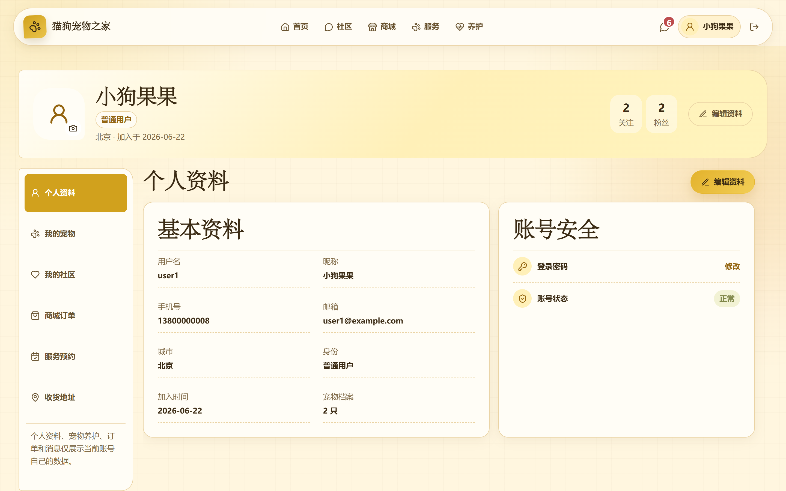<br /><sub>个人中心</sub></td>
  </tr>
</table>

### 商家中心

<table>
  <tr>
    <td width="50%" align="center">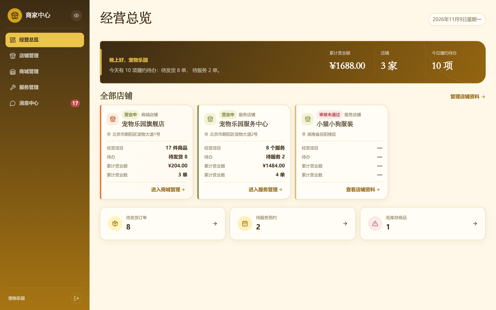<br /><sub>商家经营总览</sub></td>
    <td width="50%" align="center">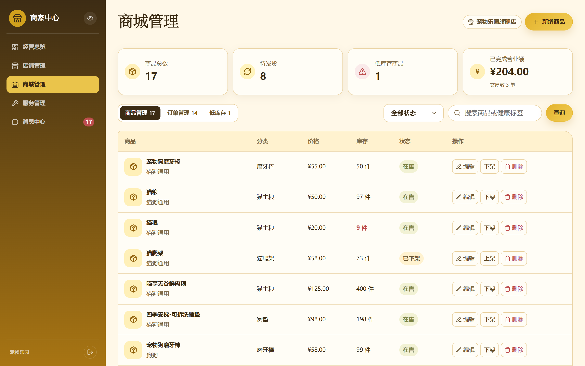<br /><sub>商城管理（商品 / 订单 / 预约）</sub></td>
  </tr>
</table>

### 管理后台

<table>
  <tr>
    <td width="50%" align="center">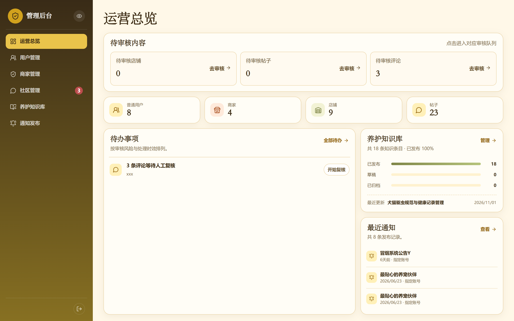<br /><sub>运营总览</sub></td>
    <td width="50%" align="center">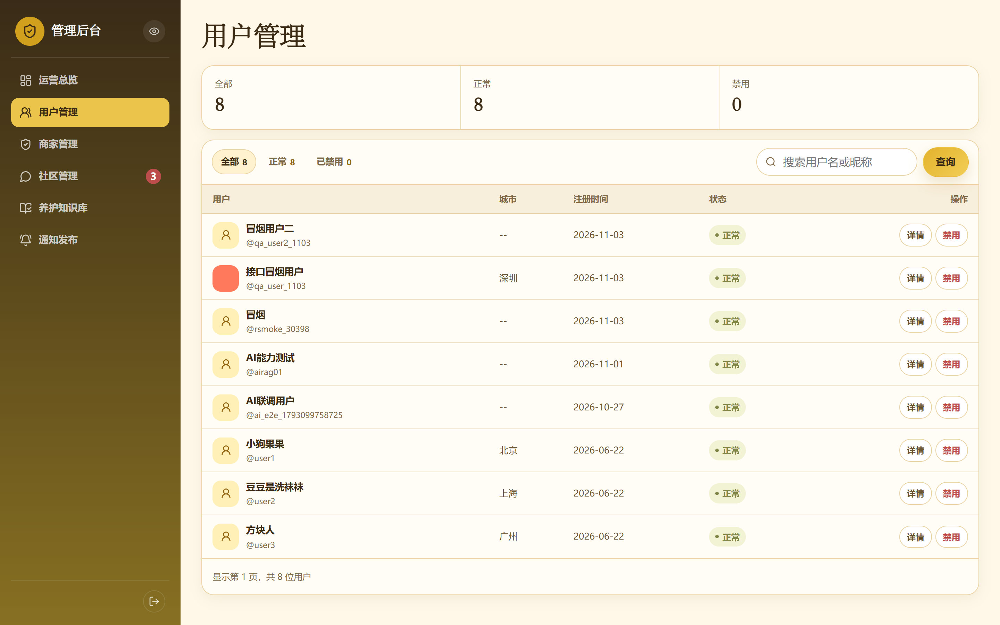<br /><sub>用户管理</sub></td>
  </tr>
</table>

## 本地运行

### 环境要求

- JDK 21
- Maven 3.9+
- Node.js 20.19+ 或 22.12+（Vite 7 要求）
- MySQL 8
- Redis 7（可用 `deploy/redis/docker-compose.yml` 一键启动）
- RabbitMQ 3.13（可用 `deploy/rabbitmq/docker-compose.yml` 一键启动）
- DeepSeek API Key（AI 顾问 / 评论 AI 审核 / 健康报告需要）
- 百炼 API Key 与 Milvus（可选，仅 RAG 知识库检索需要）

### 1. 获取代码

```bash
git clone <repository-url>
cd 猫狗宠物之家
```

### 2. 初始化数据库

先创建数据库，再导入自带演示数据的完整脚本：

```sql
CREATE DATABASE pet_home DEFAULT CHARACTER SET utf8mb4;
```

```bash
mysql -uroot -p pet_home < backend/database/full/pet_home_full_schema.sql
```

### 3. 启动中间件

Redis 与 RabbitMQ 提供了开发用 docker compose（凭据与端口与后端默认配置一致）：

```bash
docker compose -f deploy/redis/docker-compose.yml up -d
docker compose -f deploy/rabbitmq/docker-compose.yml up -d
```

MySQL 需自行准备；若本机已有 Redis / RabbitMQ / MySQL，直接改用对应环境变量即可。

### 4. 配置

后端开发配置（`application-dev.yml`）已内置开发默认值：数据库密码 `1234`、Redis 与 RabbitMQ 凭据 `root/1234`、开发用 JWT 密钥。仅需在 `backend/.env.local`（properties 格式，已被 git 忽略）写入自己的密钥：

```properties
DB_PASSWORD=你的MySQL密码
DEEPSEEK_API_KEY=你的DeepSeek密钥
```

需要 RAG 知识库检索时，追加 `RAG_ENABLED=true`、`DASHSCOPE_API_KEY` 与 Milvus 相关变量；未配置时 RAG 关闭，AI 顾问仍可正常对话。

### 5. 启动服务

启动后端：

```bash
cd backend
mvn spring-boot:run
```

服务默认监听 `8080` 端口，上下文路径为 `/petHome`，接口健康检查：

```text
http://localhost:8080/petHome/api/token/check
```

启动前端：

```bash
cd frontend
npm install
npm run dev
```

浏览器访问：

```text
http://127.0.0.1:5173/petHome/
```

Vite 会把 `/petHome/api` 与 `/petHome/uploads` 代理到本地后端（默认 `http://127.0.0.1:8080`，可用 `VITE_BACKEND_TARGET` 覆盖）。

### 6. 演示账号

数据库脚本自带演示数据，以下账号密码均为 `123456`：

| 角色 | 用户名 | 昵称 | 说明 |
| --- | --- | --- | --- |
| 管理员 | `admin` | 系统管理员 | 运营总览、用户 / 商家 / 社区 / 知识库管理 |
| 商家 | `biz1` | 宠物乐园 | 商家中心、店铺 / 商品 / 服务 / 预约管理 |
| 用户 | `user1` | 小狗果果 | 社区、商城、服务预约、宠物养护（含两只宠物档案） |

### 7. 构建部署

构建后端可执行包：

```bash
cd backend
mvn clean package
```

构建前端静态资源（输出到 `frontend/dist`）：

```bash
cd frontend
npm run build
```

生产部署参考 `deploy/nginx-pet-home.conf`：前端静态资源置于 `/var/www/petHome/`，`/petHome/api` 与 `/petHome/uploads` 反代到后端 8080，生产环境必须在 `application-prod.yml` / 环境变量中覆盖数据库、Redis、RabbitMQ 凭据与 `JWT_SECRET`，并开启 MCP 访问边界（`MCP_SECURITY_ENABLED=true`）。

## 主要配置

| 环境变量 | 默认值 | 说明 |
| --- | --- | --- |
| `SERVER_PORT` | `8080` | 后端端口，上下文路径固定 `/petHome` |
| `DB_URL` | `jdbc:mysql://localhost:3306/pet_home` | MySQL 连接串 |
| `DB_USERNAME` / `DB_PASSWORD` | `root` / dev 为 `1234` | 数据库凭据 |
| `REDIS_HOST` / `REDIS_PORT` | `127.0.0.1` / `6379` | Redis 地址 |
| `REDIS_USERNAME` / `REDIS_PASSWORD` | `root` / `1234` | Redis ACL 账号（见 `deploy/redis/redis.conf`） |
| `RABBITMQ_HOST` / `RABBITMQ_PORT` | `127.0.0.1` / `5673` | RabbitMQ AMQP 端口 |
| `RABBITMQ_USERNAME` / `RABBITMQ_PASSWORD` | `root` / `1234` | MQ 凭据，生产必须覆盖 |
| `JWT_SECRET` | dev 内置默认值 | JWT 密钥，生产必须覆盖为强随机串 |
| `JWT_EXPIRATION_SECONDS` | `86400` | 会话有效期 |
| `JWT_COOKIE_NAME` | `pet_home_token` | HttpOnly 会话 Cookie |
| `APP_UPLOAD_ROOT` | `./uploads` | 上传文件根目录 |
| `DEEPSEEK_API_KEY` | 空 | DeepSeek 密钥，未配置时 AI 能力不可用 |
| `DEEPSEEK_MODEL` | `deepseek-chat` | 对话模型 |
| `DEEPSEEK_ENABLED` | `true` | AI 业务总开关（含评论 AI 审核） |
| `DEEPSEEK_DAILY_LIMIT` / `DEEPSEEK_MINUTE_LIMIT` | `20` / `5` | 用户 AI 调用配额 |
| `AI_STREAM_TIMEOUT_MILLIS` | `120000` | AI 流式对话超时 |
| `RAG_ENABLED` | `false` | RAG 总开关，关闭时零 Milvus 连接 |
| `MILVUS_URI` / `MILVUS_COLLECTION_NAME` | `http://127.0.0.1:19530` / `pet_knowledge_chunks_v2` | 向量库地址与集合 |
| `DASHSCOPE_API_KEY` / `EMBEDDING_MODEL` | 空 / `text-embedding-v4` | 百炼 Embedding（OpenAI 兼容端点） |
| `EMBEDDING_DIMENSION` / `RAG_TOP_K` | `1024` / `4` | 向量维度与召回条数 |
| `MCP_SECURITY_ENABLED` / `MCP_API_KEY` | `false` / 空 | MCP 端点 API Key 边界，生产必须开启 |
| `LOG_LEVEL` | `INFO` | 后端日志级别，排查时可调 `DEBUG` |

## 接口概览

REST 接口统一前缀 `/petHome/api`（兼容 `/api/v1` 别名），下表为模块级概览：

| 模块 | 路径示例 | 说明 |
| --- | --- | --- |
| 认证 | `/api/login`、`/api/v1/auth/register`、`/token/check`、`/auth/logout`、`/auth/password` | 登录、注册、会话校验、登出、改密 |
| 用户与宠物 | `/api/user/info`、`/user/profile`、`/user/pets`、`/user/addresses`、`/user/follow/{id}` | 个人资料、宠物档案、地址簿、关注关系 |
| 社区 | `/api/posts`、`/admin/posts`、`/admin/comments/pending`、`/admin/comments/{id}/moderation` | 帖子 / 评论、点赞关注、审核队列与复核 |
| 商城 | `/api/products`、`/api/cart`、`/api/orders`、`/merchant/orders/{id}/ship` | 商品、购物车勾选与数量、订单创建 / 取消 / 确认、商家发货 |
| 服务预约 | `/api/services`、`/services/{id}/booking-slots`、`/merchant/services/{id}/appointment-slots` | 服务列表、按天选槽、商家档期与容量管理 |
| 订单与营收 | `/api/orders/direct`、`/orders/booking`、`/merchant/revenue/summary` | 商品单 / 预约单、商家营收汇总 |
| 店铺 | `/api/merchant/shops`、`/merchant/flagship`、`/admin/shops/{id}/status` | 店铺组织、入驻审核 |
| 消息 | `/api/conversations`、`/messages/readAll`、`/admin/messages` | 私信会话、未读数、管理端通知发布 |
| AI 养护 | `/api/ai/health/conversations`、`/reminders`、`/reports/{messageId}/pdf` | SSE 流式顾问对话、养护提醒、健康报告 PDF |
| 知识库 | `/api/admin/knowledge`、`/{id}/publish`、`/{id}/archive` | 文章与分块管理、发布 / 归档、向量索引 |
| 上传 | `/api/upload/user/avatar`、`/post/image`、`/product/image`、`/logo/image` | 头像、帖子图、商品图、店铺 Logo（配额限制） |
| 商家看板 | `/api/merchant/dashboard` | 经营总览统计 |
| MCP | `/petHome/sse`、`/petHome/mcp/message` | 宠物健康档案、知识库检索、养护提醒工具 |

## License

仓库当前未附带独立 `LICENSE` 文件。对外开源、分发或商用前，需要补充明确的许可证并确认第三方依赖与素材的授权范围（其中 PDF 字体 Ma Shan Zheng 采用 OFL 授权，见 `backend/src/main/resources/fonts/OFL.txt`）。
